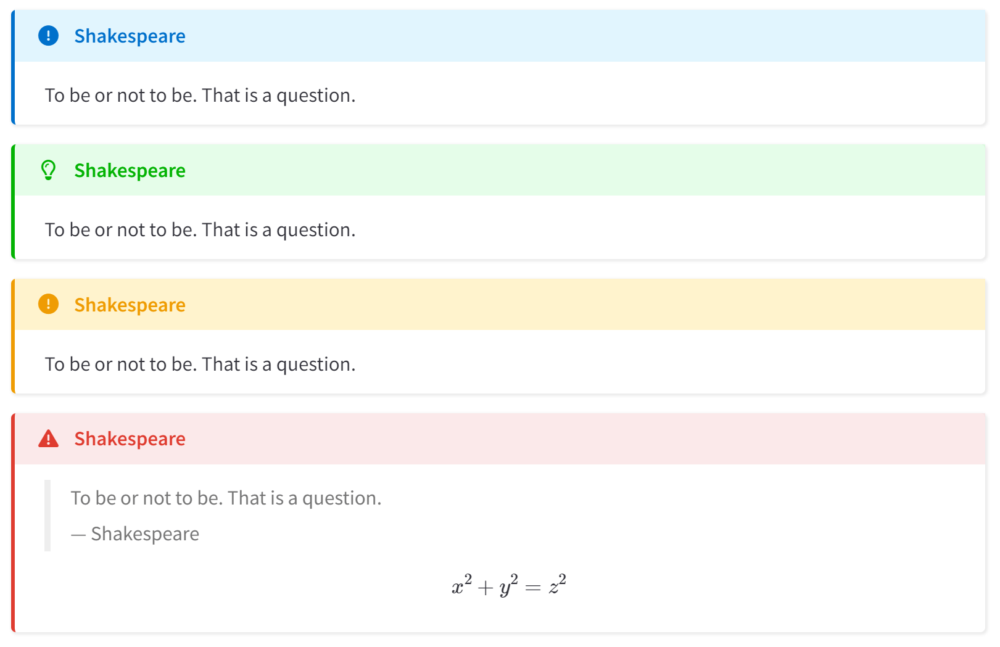
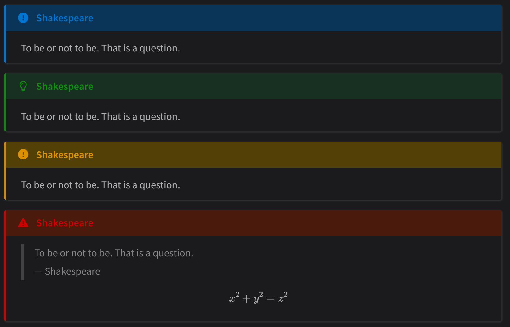
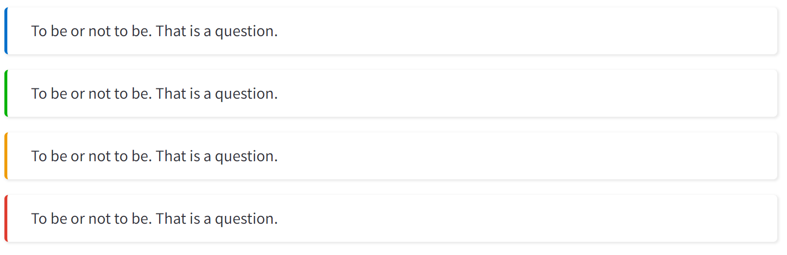
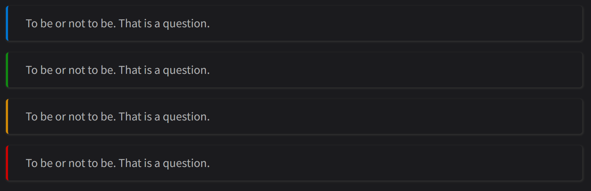
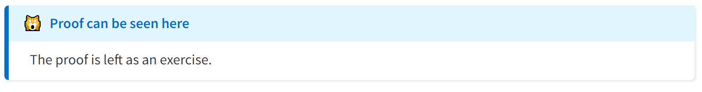

# Theory of Everything | [Huanyu Shi's Blog](https://huanyushi.github.io/) 

This site is made with [Jekyll](https://jekyllrb.com/) using the beautiful [Chirpy](https://github.com/cotes2020/jekyll-theme-chirpy/) theme. Thanks to the contributors for their work.

Theme version: **Chirpy 7.6.0** (pinned in `Gemfile`). Math rendering uses
**MathJax 4.1.3**, pinned in `_data/origin/cors.yml`, with the `physics` extension
and custom macros in `assets/js/data/mathjax.js`.

When upgrading the theme, compare `_layouts/default.html` and `_includes/footer.html`
with upstream, and check custom styles against its `data-bs-theme` color-mode attribute.

## Customization
Based on Chipy, I've made lots of customization, and I have blogged about these changes. You can see [Chirpy Blog Customization](https://huanyushi.github.io/posts/chirpy-blog-customization/) to get more details (Note that it was written in Chinese).

What I have done:
- Modify the MathJax config file to load the physics package.
- Add a background image to the sidebar and modify the associated text styles.
- Add friend links in the sidebar (see this [discussion](https://github.com/cotes2020/jekyll-theme-chirpy/discussions/1677)).
- <del>Make Further Reading display the latest posts (see this [PR](https://github.com/cotes2020/jekyll-theme-chirpy/pull/1699)).</del> (This PR has been merged after Chirpy v6.5.5)
- Add site statistics from 'buanzi'([不蒜子](https://busuanzi.ibruce.info/)) in the footer.
- Add background animation (refer to [@NichtsHsu](https://nihil.cc/)).
- Add GitHub contribution graph (via [gh-contrib-graph](https://github.com/lengthylyova/gh-contrib-graph)).

- Add 4 new prompts (see this [discussion](https://github.com/cotes2020/jekyll-theme-chirpy/discussions/1707)).

<table>
<tr>
   <th>Light</th>
   <th>Dark</th>
</tr>
<tr>
<td></td>
<td></td>
</tr>
<tr>
<td></td>
<td></td>
</tr>
</table>

- Modified the style of the `details` element.

<table>
    <tr>
        <th>Close</th>
        <td></td>
    </tr>
    <tr>
        <th>Open</th>
        <td></td>
    </tr>
</table>

- Python implementation for LQIP (Low Quality Image Placeholders) (see this [discussion](https://github.com/cotes2020/jekyll-theme-chirpy/discussions/1685)).
- Python implementation for Inverted image.

## Introduction
Here, I share study notes and ideas related to my research journey. While updates may be irregular, feel free to drop by anytime to explore. Your visit is appreciated!

Selected posts:

- [Affleck–Kennedy–Lieb–Tasaki Model](https://huanyushi.github.io/posts/aklt-model/)
- [Reading Shadows of Anyons](https://huanyushi.github.io/posts/shadow-of-anyons/)
- [Selected Exercises from Introduction to Topological Manifolds](https://huanyushi.github.io/posts/topological-manifolds-exercise/)
- [Electrostatic Field Between Two Intersecting Grounded Planes](https://huanyushi.github.io/posts/electrostatic-field-between-intersecting-planes/)
- [Derivation of General Formula for the Clebsch-Gordan Coefficients](https://huanyushi.github.io/posts/clebsh-gordan-coefficients/)
- [An Integral Involving the Product of Bessel Function and Associated Laguerre Polynomial](https://huanyushi.github.io/posts/integral-involve-bessel-laguerre/)

## License

This work is published under [MIT](LICENSE) License.
